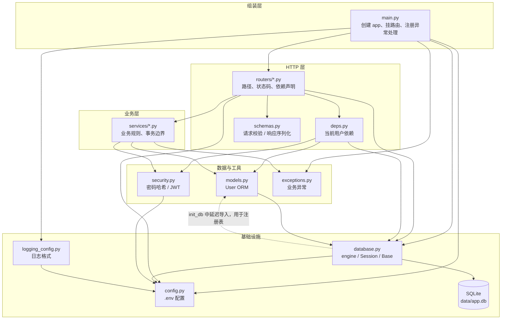
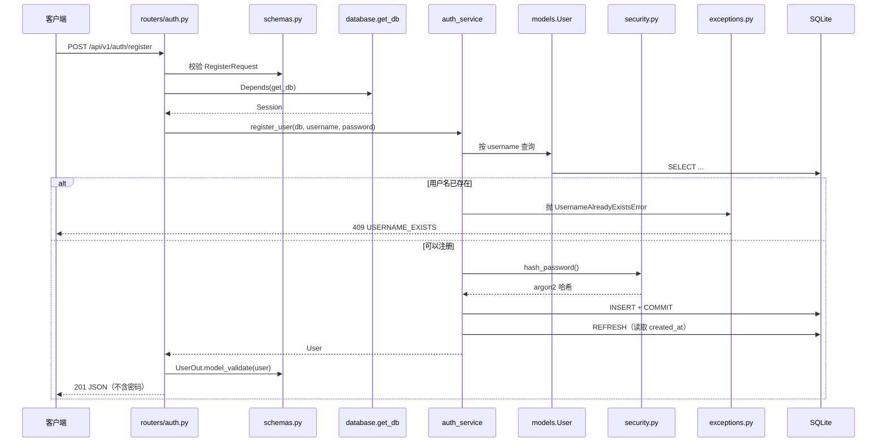

# 00 · 项目全景：分层、依赖与请求链路

> 用途：把已经写好的单个文件串成一张图。
> 更新时间：2026-10-29
> 当前范围：框架骨架 + 数据库 + 用户/JWT，共 13 个 Python 文件。

---

## 1. 先记住一句话

> **请求从 `routers` 进入，`deps` 准备上下文，`schemas` 校验数据，`services` 做业务，`models` + `database` 落到 SQLite；`main` 负责把所有零件装起来；`security`、`config`、`exceptions` 是被大家共用的工具。**

如果只记一张图，记这张：

```text
客户端
  │ HTTP
  ▼
routers ────► schemas（校验请求 / 序列化响应）
  │
  ├──────────► deps（数据库 Session、当前用户）
  │
  ▼
services（业务规则、事务）
  │
  ├──────────► security（密码哈希、JWT）
  ├──────────► exceptions（业务异常）
  ▼
models（ORM 对象）
  │
  ▼
database（engine / Session / Base）
  │
  ▼
SQLite（data/app.db）
```

`main.py` 不在业务链路里，它负责把上面的模块连接起来。

---

## 2. 容易混淆的三种「关系」

看代码时觉得乱，通常是把下面三件事混在一起了。

### 2.1 import 关系（静态）

谁在文件顶部 `from app.xxx import ...`。

例如：

```python
# app/services/auth_service.py
from app.models import User
from app.security import hash_password
```

这只说明「auth_service 需要 User 和 hash_password」，不代表请求一定会经过它们。

### 2.2 调用关系（运行时）

真正执行时，函数 A 调用了函数 B。

例如：

```text
routers/auth.py 的 register()
  → auth_service.register_user()
      → hash_password()
      → db.commit()
```

注意：`Depends(get_db)` 不是普通函数调用，而是 FastAPI 在运行时帮你解析依赖。

### 2.3 数据流（形状变化）

同一个东西在不同层有不同的「形状」：

```text
HTTP JSON
  → RegisterRequest（Pydantic，校验后的请求对象）
  → username / password（普通 Python 参数）
  → User ORM 对象
  → SQL INSERT
  → SQLite 行

返回时：
SQLite 行
  → User ORM 对象
  → UserOut（Pydantic，过滤掉密码）
  → JSON
```

看代码时分别问：

- 这个文件 import 了谁？（静态依赖）
- 这个函数运行时调用了谁？（动态调用）
- 数据在这里是什么形状？（数据流）

---

## 3. 分层图



### 3.1 每层负责什么

| 层 | 文件 | 负责 | 不应该负责 |
| --- | --- | --- | --- |
| 组装层 | `main.py` | 创建应用、挂路由、注册异常处理器、启动/关闭资源 | 业务逻辑、SQL |
| HTTP 层 | `routers/*.py` | 路径、方法、状态码、声明依赖、调用 Service | SQL、事务、密码哈希细节 |
| 依赖层 | `deps.py` | 从请求中准备「当前用户」等上下文 | 业务规则 |
| 契约层 | `schemas.py` | 请求校验、响应字段过滤、OpenAPI 文档 | 数据库表结构、业务逻辑 |
| 业务层 | `services/*.py` | 业务规则、事务提交、组合多个数据操作 | HTTP 细节、直接操作 Request/Response |
| 数据层 | `models.py` | 表结构映射、ORM 对象 | 校验、序列化 |
| 数据层 | `database.py` | engine、Session 工厂、`get_db`、建表 | 业务查询 |
| 工具层 | `security.py` | 密码哈希、JWT 签发/解码 | 查用户、业务判断 |
| 工具层 | `exceptions.py` | 表达业务错误 | HTTP 响应 |
| 基础层 | `config.py` | 读取环境变量 / `.env` | 业务逻辑 |
| 基础层 | `logging_config.py` | 统一日志格式 | 记录具体业务事件 |

---

## 4. 文件依赖总表

这张表回答三个问题：它依赖谁？谁依赖它？它碰什么外部资源？

| 文件 | 内部 import | 被谁 import | 外部资源 |
| --- | --- | --- | --- |
| `config.py` | 无 | `database`、`security`、`logging_config`、`main`、`routers/auth`、`routers/health` | `.env` |
| `logging_config.py` | `config` | `main` | Python logging |
| `exceptions.py` | 无 | `services/auth_service`、`main` | 无 |
| `schemas.py` | 无 | `routers/auth`、`routers/users` | Pydantic |
| `security.py` | `config` | `services/auth_service`、`deps` | PyJWT、pwdlib |
| `database.py` | `config`（延迟导入 `models`） | `main`、`models`、`deps`、`routers/auth`、`routers/health` | SQLAlchemy、SQLite |
| `models.py` | `database.Base` | `deps`、`services/auth_service`、`database.init_db` | SQLAlchemy |
| `deps.py` | `database`、`models`、`security` | `routers/users` | FastAPI、SQLAlchemy |
| `services/auth_service.py` | `models`、`security`、`exceptions` | `routers/auth` | SQLAlchemy |
| `routers/auth.py` | `config`、`database`、`schemas`、`services` | `main` | FastAPI |
| `routers/users.py` | `deps`、`schemas` | `main` | FastAPI |
| `routers/health.py` | `config`、`database` | `main` | FastAPI、SQLAlchemy |
| `main.py` | `config`、`database`、`exceptions`、`logging_config`、`routers/*` | Uvicorn | FastAPI |

关键观察：

1. **`config.py` 和 `exceptions.py` 不依赖任何内部模块**，所以它们在最底层，谁都可以用。
2. **`services` 不 import `database`**。它只接收一个 `Session` 对象，由 Router 通过 `Depends(get_db)` 传进来。这叫依赖注入：Service 不关心 Session 从哪来。
3. **`services` 不 import FastAPI、不 import `schemas`**。业务层不知道 HTTP 的存在。
4. **`models` 不 import `schemas`**。数据库结构不等于接口契约。
5. **`main.py` 依赖最多**，这是正常的：它是组装根（composition root），唯一知道所有零件的文件。
6. **没有反向依赖**：`database` 不会 import `services`，`models` 不会 import `routers`，`security` 不会 import `deps`。

---

## 5. 启动时发生了什么

```text
uvicorn app.main:app
  │
  ├─ 导入 app/main.py
  │    ├─ setup_logging() → 读 config，配置日志
  │    ├─ get_settings() → 读 .env，得到配置对象
  │    ├─ 创建 FastAPI app
  │    ├─ include_router(health / auth / users)
  │    │     └─ 导入 routers → services → models → database
  │    └─ 注册 AppError 异常处理器
  │
  ├─ lifespan 启动
  │    ├─ init_db()
  │    │    ├─ import app.models（确保 User 注册到 Base.metadata）
  │    │    ├─ Base.metadata.create_all() → 创建 users 表
  │    │    └─ engine.connect() → SELECT 1
  │    └─ 应用开始接收请求
  │
  └─ 进程关闭
       └─ engine.dispose()
```

一个容易忽略的点：

`database.init_db()` 里为什么要 `import app.models`？

- `Base.metadata` 只记录「已经被导入过的模型」。
- 如果 `models.py` 从未被导入，`create_all()` 不知道 `User` 存在，就不会建表。
- 虽然 `main.py` 导入 routers 时也会间接导入 models，但在 `init_db` 里显式导入，能让这个函数自己就是完整的，不依赖调用顺序。

这也是 `database.py` 和 `models.py` 之间看起来像「循环依赖」的原因：

```text
models.py       import database.Base
database.py     在 init_db 函数内部延迟 import models
```

延迟导入（函数内部 import）打破了模块导入时的循环。

---

## 6. 请求链路 A：注册



按文件顺序：

1. FastAPI 匹配 `POST /api/v1/auth/register`，进入 `routers/auth.py`。
2. 请求体先被 `schemas.RegisterRequest` 校验；不合法直接 422，不会进入函数体。
3. FastAPI 解析 `Depends(get_db)`，执行 `database.get_db()`，创建 Session。
4. Router 调用 `services/auth_service.register_user(...)`。
5. Service 用 `models.User` 查询用户名，用 `security.hash_password` 哈希密码，`db.commit()` 提交。
6. 如果唯一索引冲突，Service 抛 `exceptions.UsernameAlreadyExistsError`。
7. `main.py` 注册的异常处理器把它翻译成 409 JSON。
8. 成功时 Router 用 `schemas.UserOut` 序列化，返回 201。

---

## 7. 请求链路 B：登录

```text
POST /api/v1/auth/login
  → routers/auth.py 的 login()
  → schemas.LoginRequest 校验
  → Depends(get_db) 创建 Session
  → auth_service.login_user(db, username, password)
      → 查 User
      → security.verify_password()
          ├─ 失败：抛 InvalidCredentialsError → 401
          └─ 成功：security.create_access_token(user.id)
  → Router 组装 TokenResponse
  → 200 {"access_token": ..., "expires_in": 3600}
```

注意：

- 登录是**只读**操作，没有 `commit()`。
- Service 只返回 Token 字符串，`TokenResponse` 由 Router 组装。这样 Service 不需要知道 API 响应长什么样。

---

## 8. 请求链路 C：`GET /users/me`

这是最能体现 FastAPI 依赖注入的一条链路：

```text
GET /api/v1/users/me
  → routers/users.py 的 read_me()
  → 参数 current_user: CurrentUser
      CurrentUser = Annotated[User, Depends(get_current_user)]
  → FastAPI 解析 get_current_user
      ├─ Depends(bearer_scheme)
      │    └─ 从 Authorization 头取出 token
      ├─ Depends(get_db)
      │    └─ 创建 Session
      ├─ security.decode_access_token(token)
      │    ├─ 验签
      │    └─ 校验 exp
      ├─ payload["sub"] → user_id
      └─ db.get(User, user_id)
           ├─ 找不到 → 401
           └─ 找到 → 返回 User
  → read_me 拿到 User
  → UserOut.model_validate(user)
  → 200 JSON
```

依赖关系树：

```text
read_me
├── CurrentUser
│   └── get_current_user
│       ├── bearer_scheme（HTTPBearer）
│       ├── get_db → SessionLocal → engine → SQLite
│       ├── decode_access_token → config（密钥）
│       └── db.get(User, user_id) → users 表
└── UserOut
```

`Depends` 的关键点：

- 它不是在写普通函数调用，而是在**声明**「这个函数需要什么」。
- FastAPI 会在进入路由函数之前，自动按依赖树依次执行。
- 依赖之间可以嵌套：`get_current_user` 自己又依赖 `get_db`。
- 同一个请求内，同一个依赖默认只执行一次（可缓存），不会重复创建 Session。

---

## 9. 请求链路 D：`GET /healthz`

```text
routers/health.py
  → 不走 Service
  → 直接用 database.engine.connect()
  → SELECT 1
  → 200 / 503
```

为什么健康检查绕过 Service？

- 它没有业务规则，只是探活。
- 直接检查基础设施，不依赖业务代码。
- 健康检查不应该因为业务层改动而受影响。

---

## 10. 数据流与 JWT 流

### 10.1 普通数据

```text
请求：JSON → Pydantic 请求模型 → Python 参数 → ORM 对象 → SQL → SQLite
响应：SQLite → ORM 对象 → Pydantic 响应模型 → JSON
```

两个「形状转换」的位置：

| 位置 | 从 | 到 | 作用 |
| --- | --- | --- | --- |
| Router 入口 | JSON | Pydantic 请求模型 | 校验、类型转换、生成文档 |
| Router 出口 | ORM 对象 | Pydantic 响应模型 | 字段过滤、序列化 |

### 10.2 JWT 流

```text
注册：
  明文密码 → argon2 哈希 → hashed_password 存库

登录：
  明文密码 + 库中哈希 → verify_password → 通过
  → user.id → create_access_token（签名）
  → 返回 JWT 给客户端

访问受保护接口：
  Authorization: Bearer <token>
  → decode_access_token（验签 + 校验 exp）
  → payload["sub"] → user_id
  → 查库得到 User
  → 注入路由函数
```

---

## 11. 建议的阅读顺序

如果重新看一遍代码，按这个顺序读，会比从 `main.py` 开始更清楚：

1. `config.py`：配置从哪来。
2. `database.py`：engine、Session、`get_db`、`init_db`。
3. `models.py`：表长什么样。
4. `schemas.py`：接口的输入输出长什么样。
5. `security.py`：密码和 JWT 怎么处理。
6. `exceptions.py`：业务错误怎么表达。
7. `services/auth_service.py`：注册和登录的业务步骤。
8. `deps.py`：当前用户怎么从请求里解析出来。
9. `routers/auth.py`、`routers/users.py`、`routers/health.py`：HTTP 入口。
10. `main.py`：最后看，理解所有零件怎么被装起来。

另一种更实用的方法是**从请求倒着走**：

```text
打开 /docs
→ 选 POST /register
→ 找到 routers/auth.py 的 register()
→ 跟到 auth_service.register_user()
→ 跟到 models.User 和 security.hash_password()
→ 跟到 database.get_db()
```

---

## 12. 常见误解

1. **`main.py` 是业务中心**：不是。它只负责组装，业务在 `services`。
2. **`APIRouter` 就是一个 FastAPI 应用**：不是。它只是路由分组，必须 `app.include_router()` 才生效。
3. **`Depends(get_db)` 是普通函数调用**：不是。它是声明，FastAPI 在运行时解析。
4. **`schemas.UserOut` 和 `models.User` 是同一个东西**：不是。前者是接口契约，后者是数据库映射。
5. **Service 必须自己创建 Session**：不是。Session 由 `get_db` 创建，通过参数传进来。
6. **`database.py` 和 `models.py` 循环 import 会报错**：这里通过 `init_db()` 内部延迟导入避免了。
7. **`/healthz` 应该和业务接口一样走 Service**：不必。它是基础设施探活。
8. **`get_current_user` 每个请求都重新执行**：是的，但同一个请求内，FastAPI 会缓存依赖结果，不会重复执行。
9. **JWT 里的内容可以随便信**：payload 可读，但签名保证不可篡改；业务状态仍要查库。
10. **Router 里写 SQL 也没关系**：小项目能跑，但会让 HTTP 和数据库耦合，后面加缓存/事务时会很难改。

---

## 13. 下一步会怎么长

商品模块会按同样的模式增加：

```text
models.py           + Product
schemas.py          + ProductOut / ProductCreate
services/           + product_service.py
routers/            + products.py
main.py             include_router(products.router)
```

依赖方向不会变：

```text
routers/products.py → product_service → models.Product → database → SQLite
```

再下一步加 Redis 时，只会在 `services` 和新增的 `cache.py` 之间增加依赖，Router 和 Model 都不需要知道缓存的存在。

---

## 14. 自测：合上文档，画一遍

1. 画出 `POST /api/v1/auth/register` 经过的所有文件和函数。
2. 画出 `GET /api/v1/users/me` 的依赖树。
3. 说出 `services/auth_service.py` 依赖哪些模块，以及它**不**依赖哪些模块。
4. 说出 `database.py` 和 `models.py` 的导入关系，并解释为什么不会循环导入。
5. 如果要在注册成功后发一封邮件，应该改哪一层？为什么？
6. 如果把密码哈希逻辑从 `security.py` 挪到 Router 里，会破坏什么？
7. 如果以后商品接口也要校验登录，应该复用哪个依赖？
8. 如果新增 Redis 缓存，应该让 Router 直接读 Redis 吗？为什么？
