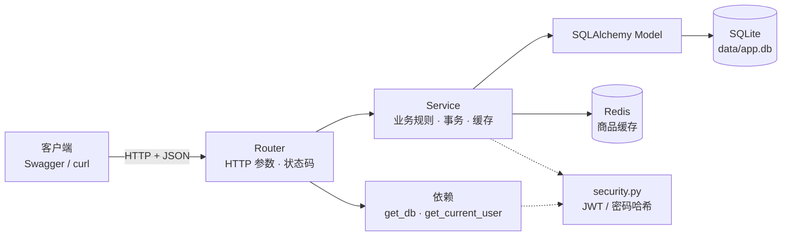

# MiniMall 精简版架构蓝图

> 版本：0.2（学习优先版）
> 日期：2026-10-27
> 技术栈：Python 3.11 · FastAPI · SQLite + SQLAlchemy（同步）· Redis · JWT · Docker
> 目标：用最少的代码和最低的环境成本，跑通一条完整的业务链路，理解 FastAPI 各部分的职责与关联。

---

## 0. 这一版的目标

你不需要生产级架构，只需要看懂：

1. 一个请求从进入 FastAPI 到返回，经过了哪些文件、哪些函数。
2. Router、Service、数据库、Redis 各自负责什么。
3. JWT 到底怎么签发、怎么携带、怎么校验。
4. 一个下单动作如何保证「扣了库存就一定生成订单」。
5. 最后如何用 Docker 把应用和 Redis 一起打包运行。

所以本版刻意做了减法：**不用 MySQL、不用异步、不用 Alembic、不拆 Repository、不做购物车和幂等**。这些不是不重要，而是等你先看懂主链路之后再逐个加。

---

## 1. 最终做出来的东西

一条最小但完整的电商链路：

```text
注册 → 登录拿 Token → 查看商品（Redis 缓存）→ 下单（事务扣库存）→ 查看我的订单 → 取消订单（恢复库存）
```

功能清单：


| 模块   | 功能                    |
| ---- | --------------------- |
| 认证   | 注册、登录、查看当前用户          |
| 商品   | 商品列表、商品详情（走 Redis 缓存） |
| 订单   | 下单、我的订单列表、订单详情、取消订单   |
| 基础设施 | 健康检查、统一错误、Docker 打包   |


不做的：购物车、支付、退款、多商品订单、管理员后台、限流、幂等、消息队列、微服务。

---


## 2. 技术选型（精简版）


| 选型                      | 用途          | 为什么选它                      |
| ----------------------- | ----------- | -------------------------- |
| FastAPI                 | Web 框架      | 自动生成 Swagger 文档，依赖注入清晰     |
| SQLAlchemy 2.0（同步）      | ORM         | 控制流直白，不需要理解 `await` 和异步连接池 |
| SQLite                  | 数据库         | 零安装、单文件，项目跑起来就有一个 `app.db` |
| Redis 7                 | 缓存          | 只做商品详情缓存，用 Docker 启动       |
| PyJWT                   | 签发/校验 Token | 代码只有几行，便于看清 JWT 原理         |
| pwdlib + argon2         | 密码哈希        | 不存明文密码                     |
| pydantic-settings       | 配置          | 从 `.env` 读取配置              |
| Docker + Docker Compose | 打包运行        | 一条命令启动应用和 Redis            |
| Swagger UI              | 调接口         | FastAPI 自带，不需要 Postman     |
| pytest（可选）              | 测试          | Phase 6 再加，不影响主链路          |


### 2.1 为什么不用 MySQL

SQLite 不需要安装服务、不需要账号密码、不需要端口，数据就是一个文件。

- 学习框架和业务链路：完全够用。
- 事务、条件更新、外键这些概念照样能练。
- 以后想换 MySQL/PostgreSQL，主要改 `DATABASE_URL` 和驱动，业务代码基本不动。

**代价**：SQLite 的并发写入能力弱，不适合做高并发压测。所以本版不安排「100 并发抢库存」实验，只验证逻辑正确性。

### 2.2 为什么不用异步

同步代码从上到下执行，事务边界、异常传播、调试堆栈都更直观。

FastAPI 对 `def` 路由会自动放到线程池执行，学习项目完全够用。以后转异步，主要是把函数改成 `async def`、加 `await`、换异步驱动。

### 2.3 为什么不用 Alembic 和 Repository

- **Alembic**：学习阶段用 `Base.metadata.create_all()` 启动时建表即可。生产项目才需要迁移历史。
- **Repository**：这个项目查询很少，Service 里直接写 SQLAlchemy 查询更省文件。等查询复杂了，再把查询抽到 Repository，这个重构过程本身也是很好的练习。

这些取舍都会在文档最后统一列出，方便你以后知道「什么时候该加回来」。

---


## 3. 总体架构




### 3.1 每个部分负责什么


| 部分   | 文件                | 负责                                    | 不负责         |
| ---- | ----------------- | ------------------------------------- | ----------- |
| 应用入口 | `app/main.py`     | 创建 app、注册路由、启动时建表、健康检查                | 业务逻辑        |
| 配置   | `app/config.py`   | 从 `.env` 读取密钥、数据库地址、Redis 地址          | 业务逻辑        |
| 数据库  | `app/database.py` | engine、Session、`get_db`、`Base`        | 查询业务数据      |
| 模型   | `app/models.py`   | 表结构：User / Product / Order            | 校验、序列化      |
| 接口模型 | `app/schemas.py`  | 请求体校验、响应序列化、Swagger 文档                | 数据库结构       |
| 安全   | `app/security.py` | 密码哈希、JWT 签发与解码                        | 查用户、业务判断    |
| 依赖   | `app/deps.py`     | `get_db`、`get_current_user`、Redis 客户端 | 业务逻辑        |
| 路由   | `app/routers/`    | 路径、方法、状态码、调用 Service                  | SQL、事务、缓存实现 |
| 服务   | `app/services/`   | 业务规则、事务提交、缓存读写                        | HTTP 细节     |
| 缓存   | `app/cache.py`    | Redis 连接、商品缓存的读/写/删                   | 业务判断        |
| 种子数据 | `seed.py`         | 插入几件商品，方便演示                           | 业务逻辑        |


### 3.2 调用规则

```text
Router → Service → SQLAlchemy → SQLite
              ↘ cache.py → Redis
```

1. Router 只做三件事：解析参数、声明依赖、调用 Service。
2. 所有事务提交放在 Service。
3. Redis 的读写细节放在 `cache.py`，Router 不直接操作 Redis。
4. 数据库 Model 不直接作为响应返回，统一由 Schema 序列化。
5. 依赖注入负责「准备好资源」：数据库 Session、当前用户、Redis 客户端。


### 3.3 一次下单请求的完整路线

以 `POST /api/v1/orders` 为例：

```text
1. Uvicorn 收到请求，交给 FastAPI
2. FastAPI 解析路由，执行依赖：
   - get_db() 打开数据库 Session
   - get_current_user() 从 Authorization 头取出 Token
       → security.py 校验签名和过期时间
       → 用 Token 里的 user_id 查数据库
   - 得到 current_user 和 db
3. Router 用 OrderCreate 校验请求体（product_id、quantity）
4. Router 调用 order_service.create_order(db, current_user, payload)
5. Service：
   - 查商品是否上架、库存是否足够
   - 条件 UPDATE 扣库存（影响行数为 0 就回滚并报错）
   - 插入订单，保存商品名称、单价、数量等快照
   - commit
   - 删除 Redis 里的商品详情缓存
6. Router 用 OrderOut 序列化，返回 201
7. 依赖清理：Session 关闭（异常时回滚）
```

这张链路图是 Phase 3 结束时你应该能自己画出来的东西。

---


## 4. 目录结构

```text
a-little-exercise/
├── app/
│   ├── main.py              # 创建 app、路由注册、建表、健康检查
│   ├── config.py            # 配置（.env）
│   ├── database.py          # engine / SessionLocal / Base / get_db
│   ├── models.py            # User / Product / Order
│   ├── schemas.py           # 请求与响应模型
│   ├── security.py          # 密码哈希、JWT 签发与解码
│   ├── deps.py              # get_db、get_current_user、Redis 依赖
│   ├── cache.py             # 商品缓存 get / set / delete
│   ├── routers/
│   │   ├── auth.py
│   │   ├── products.py
│   │   └── orders.py
│   └── services/
│       ├── auth_service.py
│       ├── product_service.py
│       └── order_service.py
├── data/                    # SQLite 文件目录（不提交）
├── seed.py                  # 插入示例商品
├── tests/                   # 可选，Phase 6
├── Dockerfile
├── docker-compose.yml
├── .env.example
├── .dockerignore
├── requirements.txt
└── README.md
```

文件不多，每个文件都能一眼看完。这是有意为之：先建立整体感，再谈扩展。

---


## 5. JWT 到底怎么用


### 5.1 JWT 解决什么问题

HTTP 本身是无状态的：服务器不记得上一个请求是谁发的。

传统方案是 Session：登录后服务器存一份会话，给浏览器一个 Cookie。JWT 的思路是反过来：

> 登录成功后，服务器发一个**带签名的令牌**。之后客户端每次请求都带上它，服务器只需要验证签名，就能知道「这是谁」。

服务器不需要保存会话，所以叫「无状态鉴权」。

### 5.2 三个步骤

**第一步：注册**

```text
用户名 + 密码
  → 检查用户名是否重复
  → 用 argon2 把密码哈希
  → 存数据库（绝不存明文）
```

**第二步：登录，签发 Token**

```python
# app/security.py 的核心逻辑
payload = {
    "sub": str(user.id),                      # subject：这是谁
    "exp": datetime.now(timezone.utc)         # 过期时间
           + timedelta(minutes=60),
}
token = jwt.encode(payload, settings.jwt_secret, algorithm="HS256")
```

返回给客户端：

```json
{"access_token": "eyJhbGciOi...", "token_type": "bearer", "expires_in": 3600}
```

**第三步：访问受保护接口**

客户端带上请求头：

```http
Authorization: Bearer eyJhbGciOi...
```

服务端依赖解析它：

```python
def get_current_user(credentials=Depends(bearer), db=Depends(get_db)):
    if credentials is None:
        raise HTTPException(401, "未登录")

    try:
        payload = jwt.decode(
            credentials.credentials,
            settings.jwt_secret,
            algorithms=["HS256"],
        )
    except jwt.PyJWTError:
        raise HTTPException(401, "Token 无效或已过期")

    user = db.get(User, int(payload["sub"]))
    if user is None:
        raise HTTPException(401, "用户不存在")
    return user
```

之后 Router 里只需要写：

```python
def create_order(user: User = Depends(get_current_user), ...):
    ...
```


### 5.3 必须理解的几个点

1. **JWT 是签名，不是加密**。任何人都能 Base64 解码出 payload，只是改不了内容。**不要往里面放密码、手机号等敏感信息**。
2. **签名密钥** `JWT_SECRET` **必须保密**。泄露了，别人就能伪造任意用户。
3. **过期时间** `exp` **很重要**。`jwt.decode` 会自动校验过期并抛异常。
4. **Token 不是越久越好**。本版设 60 分钟；登出后 Token 在过期前理论上仍有效，这是 JWT 的固有特点。想立刻失效需要 Redis 黑名单，留作扩展。
5. **权限以数据库为准**。Token 里只放 `user_id`，每次请求查库拿最新状态，不要在 Token 里放角色然后完全相信它。
6. **生产环境必须 HTTPS**。Token 在请求头里传输，明文 HTTP 会被截获。
7. **401 和 403 的区别**：401 是「你是谁我不知道」；403 是「我知道你是谁，但你没权限」。


### 5.4 本版不做的 JWT 高级功能

- Refresh Token（双 Token 续期）
- 登出黑名单
- 多设备管理
- OAuth2 / 第三方登录

先跑通「登录 → 带 Token → 识别用户」，这些以后再加。

---


## 6. 数据库设计（SQLite）


### 6.1 三张表

**users**


| 字段              | 类型                 | 说明        |
| --------------- | ------------------ | --------- |
| id              | INTEGER PK         | 自增        |
| username        | VARCHAR(32) UNIQUE | 登录名       |
| hashed_password | VARCHAR(255)       | argon2 哈希 |
| created_at      | DATETIME           | 创建时间      |


**products**


| 字段          | 类型           | 说明              |
| ----------- | ------------ | --------------- |
| id          | INTEGER PK   |                 |
| name        | VARCHAR(120) | 商品名             |
| description | TEXT         | 描述              |
| price_cents | INTEGER      | 单价，单位「分」，避免浮点误差 |
| stock       | INTEGER      | 库存              |
| is_active   | BOOLEAN      | 是否上架            |
| created_at  | DATETIME     |                 |


**orders**


| 字段               | 类型            | 说明                      |
| ---------------- | ------------- | ----------------------- |
| id               | INTEGER PK    |                         |
| user_id          | INTEGER       | 下单用户                    |
| product_id       | INTEGER       | 商品 ID                   |
| product_name     | VARCHAR(120)  | **下单时的商品名快照**           |
| unit_price_cents | INTEGER       | **下单时的单价快照**            |
| quantity         | INTEGER       | 数量                      |
| total_cents      | INTEGER       | 总价 = 单价 × 数量            |
| status           | VARCHAR(16)   | `CREATED` / `CANCELLED` |
| created_at       | DATETIME      |                         |
| cancelled_at     | DATETIME NULL |                         |


### 6.2 设计要点

1. **金额用整数「分」**：`1990` 表示 19.90 元。避免 `FLOAT` 的精度问题，也不需要处理 `DECIMAL`。
2. **订单保存快照**：商品以后改价、改名，历史订单不能跟着变。所以订单表冗余 `product_name`、`unit_price_cents`。
3. **订单只记录一个商品**：本版刻意简化，一个订单对应一个商品。以后做多商品订单，再加 `order_items` 表。
4. **建表方式**：启动时 `Base.metadata.create_all(bind=engine)`。这是学习阶段的简化；生产项目要用 Alembic 管理表结构。
5. **不物理删除**：商品用 `is_active` 下架；订单只改状态。
6. **时间统一 UTC**：避免本地时区带来的混乱。

---


## 7. Redis 缓存

本版只用一个缓存场景：**商品详情**。目的不是追求性能，而是看懂「缓存怎么和数据库配合」。

### 7.1 Key 设计


| 项目    | 内容                |
| ----- | ----------------- |
| Key   | `product:{id}`    |
| Value | 商品详情的 JSON 字符串    |
| TTL   | 60 秒（故意设短，方便观察过期） |


### 7.2 读取流程（Cache-Aside）

```text
GET /products/{id}
  → 查 Redis
      命中 → 直接返回
      未命中 → 查 SQLite
              → 不存在/已下架 → 404
              → 写入 Redis（EX 60）
              → 返回
```


### 7.3 写入后如何保证缓存不过期

下单扣库存、取消订单恢复库存之后，商品库存已经变了，缓存里的 `stock` 就旧了。

处理规则：**先提交数据库，再删除缓存**。

```python
db.commit()
cache.delete_product(product_id)   # 下次读取时重新从数据库加载
```

不直接更新缓存，因为并发更新时容易把旧值写回去。删除更简单、更安全。

如果删除失败：记录日志，接受最多 60 秒的旧数据。缓存不是数据的真相，数据库才是。

### 7.4 Redis 挂了怎么办

在 `cache.py` 里捕获 `redis.RedisError`：

```python
def get_product_cache(product_id: int):
    try:
        raw = redis_client.get(f"product:{product_id}")
        return json.loads(raw) if raw else None
    except redis.RedisError:
        logger.warning("Redis 不可用，降级查询数据库")
        return None
```

这样 Redis 挂掉时，商品详情还能查数据库，只是变慢。这就是「缓存降级」。

### 7.5 不要做什么

- 不要只在 Redis 里存库存，然后拿 Redis 当库存真相。
- 不要在数据库事务提交前写缓存。
- 不要把订单状态只放 Redis。
- 缓存里的数据必须能由数据库重建。

---


## 8. API 设计


### 8.1 约定

- 基础路径：`/api/v1`；健康检查：`/healthz`
- 请求和响应都是 JSON
- 鉴权头：`Authorization: Bearer <token>`
- 金额字段单位：分（整数）
- 错误直接使用 FastAPI 的 `HTTPException`：

```json
{"detail": "库存不足"}
```

学习阶段不用做复杂的错误码体系，先理解「状态码 + detail」即可。

### 8.2 接口清单


| 方法   | 路径                           | 鉴权  | 说明                | 阶段  |
| ---- | ---------------------------- | --- | ----------------- | --- |
| GET  | `/healthz`                   | 否   | 检查 SQLite 和 Redis | P0  |
| POST | `/api/v1/auth/register`      | 否   | 注册                | P1  |
| POST | `/api/v1/auth/login`         | 否   | 登录，返回 JWT         | P1  |
| GET  | `/api/v1/users/me`           | 是   | 当前用户              | P1  |
| GET  | `/api/v1/products`           | 否   | 商品列表              | P2  |
| GET  | `/api/v1/products/{id}`      | 否   | 商品详情（走缓存）         | P2  |
| POST | `/api/v1/orders`             | 是   | 下单                | P3  |
| GET  | `/api/v1/orders`             | 是   | 我的订单              | P4  |
| GET  | `/api/v1/orders/{id}`        | 是   | 订单详情              | P4  |
| POST | `/api/v1/orders/{id}/cancel` | 是   | 取消订单并恢复库存         | P4  |


### 8.3 关键请求示例

**注册**

```http
POST /api/v1/auth/register
{"username": "alice", "password": "S3cret!"}
```

**登录**

```http
POST /api/v1/auth/login
{"username": "alice", "password": "S3cret!"}
```

```json
{"access_token": "eyJ...", "token_type": "bearer", "expires_in": 3600}
```

**下单**

```http
POST /api/v1/orders
Authorization: Bearer eyJ...
{"product_id": 1, "quantity": 2}
```

**商品详情响应**

```json
{
  "id": 1,
  "name": "机械键盘",
  "price_cents": 19900,
  "stock": 10,
  "is_active": true
}
```

---


## 9. 核心业务流程


### 9.1 登录

```text
POST /auth/login
  → AuthService.login
      → 按用户名查 User
      → 用户不存在 / 密码错误 → 401（同一个提示，避免暴露用户名是否存在）
      → pwdlib 校验密码
      → security.create_access_token(user.id)
  → 返回 access_token
```


### 9.2 商品详情（缓存）

```text
GET /products/{id}
  → ProductService.get_detail
      → cache.get_product_cache(id)
          ├─ 命中：反序列化返回
          └─ 未命中：查 SQLite
                → 不存在/下架：404
                → cache.set_product_cache(id, data, ttl=60)
                → 返回
```


### 9.3 下单（最关键的一段）

```text
POST /orders
  → Router 校验请求体
  → get_current_user 得到用户
  → OrderService.create_order(db, user, product_id, quantity)
      1. 查商品：不存在或已下架 → 404
      2. 条件更新库存：
         UPDATE products
         SET stock = stock - :quantity
         WHERE id = :product_id AND stock >= :quantity
      3. 影响行数为 0 → rollback，返回 409「库存不足」
      4. 影响行数为 1 → 插入订单（保存商品名、单价、数量快照）
      5. commit
      6. 删除商品缓存
  → 返回 201 + 订单信息
```

**为什么用条件 UPDATE，而不是先查再判断？**

```python
# 错误示范：并发下两个请求可能都看到库存 1
if product.stock >= quantity:
    product.stock -= quantity
```

两个请求同时读到 `stock=1`，都认为够，最后库存变成 -1。

```python
# 正确做法：数据库在一条语句里完成「判断 + 扣减」
UPDATE products SET stock = stock - 2
WHERE id = 1 AND stock >= 2
```

影响行数是 0 就说明库存不够。判断和扣减是一个原子操作，不会互相穿插。这是本版最重要的一行 SQL。

**事务边界**：

- 扣库存、插订单必须在同一个事务里。
- 任何一步失败都要回滚，不能出现「库存扣了但订单没生成」。
- `db.commit()` 只在 Service 里调用。
- Redis 操作不能参与数据库事务，所以放在 commit 之后。

**缓存失效**：

```text
commit 成功 → cache.delete_product(product_id)
```

下单后商品库存变了，缓存必须删除，否则详情页会显示旧库存，最长 60 秒。

### 9.4 取消订单

```text
POST /orders/{id}/cancel
  → 查询订单，必须属于当前用户
  → 条件更新订单状态：
      UPDATE orders SET status='CANCELLED'
      WHERE id=? AND user_id=? AND status='CREATED'
  → 影响行数为 0 → 已取消或不存在 → 返回 409/404
  → 恢复库存：UPDATE products SET stock = stock + quantity
  → commit
  → 删除商品缓存
```

订单状态变更和库存恢复必须在同一个事务里，避免「订单取消了但库存没加回来」。

重复取消：第二次条件更新影响行数为 0，返回 409 或直接返回订单当前状态，二选一，在接口文档里写清楚。

---


## 10. 分阶段实施路线

每个阶段都能独立运行、独立验收，不要一次性写完再调试。

### Phase 0：骨架与健康检查（半天）

**产出**

- 虚拟环境、`requirements.txt`、`.env.example`
- `config.py`、`database.py`、`models.py` 空模型
- `main.py`：创建 app、启动建表、`/healthz`
- `docker-compose.yml`：只启动 Redis
- Swagger 可访问

**验收**

- `docker compose up -d` 后 Redis 正常。
- `uvicorn app.main:app --reload` 启动成功。
- `/healthz` 返回 200，同时显示 SQLite 与 Redis 状态。
- `data/app.db` 自动创建。

**要能回答**

- FastAPI 启动时做了什么？
- `get_db` 的 `yield` 前后分别发生什么？
- 为什么数据库连接不放在每个请求里新建？

---


### Phase 1：注册、登录、JWT（1 天）

**产出**

- `User` 表
- `schemas.py`：注册、登录、用户响应
- `security.py`：密码哈希、JWT 签发/解码
- `deps.py`：`get_current_user`
- `routers/auth.py`、`services/auth_service.py`
- `GET /users/me`

**验收**

- 注册后能登录，拿到 Token。
- 不带 Token 访问 `/users/me` 返回 401。
- 带伪造或过期 Token 返回 401。
- 数据库里的密码是哈希，不是明文。
- 重复用户名返回 400/409。

**要能回答**

- JWT 的三段分别是什么？签名的作用是什么？
- 为什么 JWT 不安全存放敏感信息？
- `get_current_user` 在什么时候执行？它和路由函数的参数是什么关系？
- 为什么每次请求还要查数据库，而不是完全相信 Token？

---


### Phase 2：商品与 Redis 缓存（1 天）

**产出**

- `Product` 表
- `seed.py` 插入 3 件示例商品
- 商品列表、详情接口
- `cache.py`：Redis 连接、商品缓存读写删
- 商品详情 cache-aside
- 下单前还没有订单，先用一个临时接口或手动改库存来观察缓存失效？——不需要，Phase 3 会自然验证

**验收**

- 两次请求商品详情，第二次命中缓存（日志可证）。
- 用 `redis-cli TTL product:1` 能看到 60 秒左右的剩余时间。
- Redis 停止后，商品详情仍能返回（降级查数据库）。
- 商品不存在返回 404。

**要能回答**

- 为什么先查缓存、再查数据库？
- 为什么更新数据后是删除缓存而不是更新缓存？
- 缓存和数据库短暂不一致的窗口在哪？本项目如何把窗口控制在 60 秒内？

---


### Phase 3：下单事务（1~2 天）

**产出**

- `Order` 表
- `OrderCreate` / `OrderOut` Schema
- `OrderService.create_order`
- 条件 UPDATE 扣库存
- 订单快照字段
- commit 后删除商品缓存
- 并发正确性验证（本地串行验证逻辑，SQLite 下不做高并发压测）

**验收**

- 库存 10，下单 2，库存变 8，订单生成。
- 库存 1，下单 2，返回 409，库存仍是 1，没有订单。
- 数据库出错时（可临时制造异常），库存和订单一起回滚。
- 下单后第一次查商品详情，看到的是新库存（缓存已删除）。
- 订单里的单价是下单时的价格；手动改商品价格后，历史订单不变。

**要能回答**

- 事务从哪开始、到哪结束？为什么 commit 放在 Service？
- 条件 UPDATE 的影响行数代表什么？
- 为什么 Redis 操作不能放进数据库事务？
- 如果 commit 成功但删缓存失败，会发生什么？能接受吗？

---


### Phase 4：订单查询与取消（半天）

**产出**

- 我的订单列表
- 订单详情（校验归属）
- 取消订单 + 恢复库存
- 状态条件更新

**验收**

- 用户只能看到和操作自己的订单；访问别人的订单返回 404。
- 取消后库存加回，状态变为 `CANCELLED`。
- 重复取消不会重复加库存。
- 取消后商品详情缓存被删除，库存显示正确。

**要能回答**

- 为什么查别人的订单返回 404 而不是 403？
- 取消订单时，为什么状态更新和库存恢复必须在同一事务？
- 如果两个取消请求同时到达，如何保证库存只加一次？

---


### Phase 5：Docker 打包（半天）

**产出**

- `Dockerfile`
- `docker-compose.yml`：app + redis
- `.dockerignore`
- SQLite 数据目录挂载为 volume
- README：启动方式

**验收**

- `docker compose up --build` 后，`http://localhost:8000/docs` 可访问。
- 注册、登录、下单在容器里正常工作。
- `docker compose down` 再 `up`，SQLite 数据还在。
- 改代码后重新 build 生效。

**要能回答**

- Dockerfile 里每一层在做什么？为什么先 COPY `requirements.txt`？
- 容器里的 `localhost` 和宿主机有什么区别？为什么 Redis 地址是 `redis://redis:6379`？
- 为什么 SQLite 文件必须挂载出来？
- 为什么这种 SQLite + 单容器的方案不适合横向扩容？

---


### Phase 6：可选扩展（按兴趣）

按「先理解，再实现」的顺序挑：

1. pytest + TestClient 集成测试
2. 商品分页、关键词搜索
3. 管理员角色、商品创建/修改接口
4. Alembic 迁移
5. 多商品订单（`order_items` 表）
6. 下单幂等（Idempotency-Key）
7. JWT 登出黑名单
8. 登录限流
9. 切到 MySQL/PostgreSQL
10. 改成异步 SQLAlchemy

每加一项，先回答：它解决什么问题？代价是什么？失败时怎么兜底？

---


## 11. 本版的取舍清单


| 决定              | 换来什么        | 代价            | 什么时候升级                |
| --------------- | ----------- | ------------- | --------------------- |
| 用 SQLite        | 零安装、零配置、单文件 | 并发写弱、无网络服务    | 需要多人/多实例/压测时          |
| 用同步代码           | 控制流直观、调试简单  | 吞吐低于全异步       | 熟悉后再改 async           |
| `create_all` 建表 | 少一个工具、少一层概念 | 无迁移历史、改表麻烦    | 表结构开始频繁变更时            |
| 不拆 Repository   | 文件少、链路短     | Service 会逐渐变长 | 查询变复杂或需要复用时           |
| 一个订单一个商品        | 下单事务最容易看懂   | 不符合真实业务       | 理解了事务后加 `order_items` |
| 不做幂等            | 少很多代码       | 重复点击可能生成多个订单  | 想学分布式问题时              |
| Redis 只做缓存      | 职责清晰        | 没练到购物车等结构     | 想学 Hash/ZSET 时        |
| 不做支付状态          | 状态机最简单      | 订单只有创建/取消     | 想练状态机时                |


---


## 12. 常见坑

1. 明文存密码，或用可逆加密存密码。
2. `JWT_SECRET` 写死在代码里并提交到 Git。
3. 把 JWT 放在 URL 参数里，或通过 HTTP 明文传输。
4. 金额用 `FLOAT`。
5. 先查库存再更新，并发下超卖。
6. 在 Router 里 `commit()`，导致事务边界混乱。
7. 数据库 commit 前写缓存，缓存了被回滚的数据。
8. 更新缓存而不是删除缓存，并发下写入旧值。
9. 把 Redis 当订单或库存的唯一真相。
10. Docker 里的 SQLite 文件不挂载 volume，容器一删数据全没。
11. 容器里用 `localhost` 连 Redis（应该用服务名 `redis`）。
12. 只测成功路径，不测库存不足、Token 过期、重复取消。

---


## 13. 学习方式

每个 Phase 都按这个节奏：

1. **先画链路**：请求经过哪些文件、哪些函数，自己画一遍。
2. **再写代码**：一次只实现一个阶段，跑通再往下。
3. **做实验**：
  - 停掉 Redis，看商品详情是否还能用；
  - 把缓存 TTL 改成 5 秒，观察过期；
  - 故意把库存改成 0，下单看报错；
  - 把 JWT 的 secret 改掉，看旧 Token 是否失效；
  - 用 `docker compose logs` 看应用日志；
  - 用 SQLite 命令行或 DB Browser 看订单表数据。
4. **写三句话总结**：这个阶段新增了哪些文件？它们如何关联？失败时会发生什么？
5. **最后再谈优化**：先把「正确」跑通，再想「性能」。

---


## 14. 开工前检查

- [ ] Python 3.11+ 已安装
- [ ] Docker Desktop 已安装并能运行（Phase 0 启动 Redis、Phase 5 打包都要用）
- [ ] 8000、6379 端口未被占用
- [ ] 认可本版的功能范围与取舍
- [ ] 接受用 Swagger UI 调接口，不做前端

---


## 15. 下一步

从 Phase 0 开始：

1. 建目录和虚拟环境
2. 写 `requirements.txt`
3. 写 `config.py`、`database.py`
4. 写 `/healthz`
5. 用 Docker 启动 Redis
6. 启动应用，打开 `/docs`

完成标准：应用能启动、健康检查能真实反映 SQLite 和 Redis 状态，并且你能说清楚 Phase 0 每个文件为什么存在。